  

  🎧 Àudio &nbsp;|&nbsp; 📡 Processament de senyal &nbsp;|&nbsp; 🎛️ Sempre aprenent coses noves

  
  
  

---

### 🚀 Sobre mi

- 🎓 Estudio **Enginyeria en Sistemes Audiovisuals** a la **UPF**
- 🎶 M'apassiona l'**àudio**, el **processament de senyal** i tot el relacionat amb el so
- 🛠️ Actualment explorant projectes de processat i visualització d'àudio
- 🌱 Aprenent constantment noves eines i tècniques d'àudio digital
- ☁️ M'interessa també el cloud
- 📫 Contacta'm per [LinkedIn](https://www.linkedin.com/in/miquel-estruch-morais/)

---

### 🧰 Stack i eines

  <b>Llenguatges & entorn</b> 
  
  
  
  

  <b>Àudio & producció</b> 
  
  

---

### 🎯 Projecte destacat

  

---

### 📊 Estadístiques de GitHub

  
  

  

---

  <i>⭐ Sempre obert a col·laborar en projectes relacionats amb l'àudio, el processament de senyal i la tecnologia musical</i>

  

